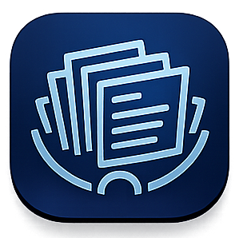

# Docs iOS

<p align="center">
  
</p>

Docs is the native iOS companion for the TODD document workspace. It provides an authenticated, tenant-scoped way to browse and manage documents from an iPhone or iPad, with a native iPad library/detail experience and signed-in handoffs to the broader Docs web application.

The app is written in SwiftUI and targets iOS 17 or later.

## What the app does

The app currently provides:

- Native Sign in with Apple and Google sign-in.
- Tenant bootstrap and tenant-scoped document access.
- Biometric session locking through `TODDAuthKit`.
- App Store entitlement checking through `TODDEntitlementKit`.
- Document listing, refresh, search, sorting, selection, metadata inspection, and deletion.
- Native image previews and video first-frame thumbnails when a document has a usable media URL.
- Native editing and creation of text/draft documents.
- Knowledge base browsing through the account menu.
- Signed-in web handoffs to Docs routes such as Home, My Documents, Upload, Studio, Knowledge Base, and Response Flow.
- Docs status metrics and account sign-out.

The iOS app and the Docs web app share the backend document data, but they do not currently have identical editing capabilities. The native editor creates and edits text documents. File uploads and rich media creation continue to be handled by the web upload flow.

## Requirements

- macOS with Xcode capable of building the iOS 17 SDK.
- XcodeGen 2.38 or newer.
- Swift 5.
- An Apple Developer signing setup for device installation or distribution.
- Access to the sibling local packages:

  - `../TODDAuthKit`
  - `../TODDEntitlementKit`

- A valid Firebase configuration for the Docs bundle identifier.
- Access to the TODD backend API and a test account with the required Docs entitlement.

The project configuration currently uses:

```text
Bundle identifier: tech.taliferro.docsios
Minimum iOS:      17.0
API base URL:     https://api.taliferro.tech/api
Product name:     DocsIOS
```

## Repository layout

```text
docs-ios/
├── DocsIOS/
│   ├── App/
│   │   ├── DocsIOSApp.swift          # App entry point and dependency construction
│   │   └── RootView.swift            # Authentication, lock, entitlement, and app routing
│   ├── Features/
│   │   ├── Auth/                     # Native sign-in UI
│   │   ├── Documents/                # Document library, detail pane, editor, and view model
│   │   ├── Paywall/                  # StoreKit subscription screen
│   │   ├── Repository/               # Knowledge base UI
│   │   └── Status/                   # Document health/status UI
│   ├── Models/
│   │   ├── DocumentModels.swift
│   │   ├── KnowledgeBaseModels.swift
│   │   └── AppStoreEntitlementModels.swift
│   ├── Services/
│   │   ├── AppConfig.swift            # Info.plist-backed configuration
│   │   ├── AuthService.swift           # Firebase auth and tenant bootstrap
│   │   ├── DocsAPIClient.swift         # Authenticated backend client
│   │   └── EntitlementService.swift   # StoreKit/backend entitlement state
│   ├── Resources/                     # App icon, Docs logo, and asset catalog
│   └── GoogleService-Info.plist       # Local Firebase configuration; do not commit
├── DocsIOS.entitlements
├── Generated/Info.plist               # XcodeGen output; do not edit directly
├── DocsIOS.xcodeproj                  # XcodeGen output; do not edit directly
└── project.yml                        # Source of truth for project generation
```

## Setup

### 1. Clone or place the repositories together

The XcodeGen project references two local Swift packages using relative paths. The expected layout is:

```text
apps/ios/
├── docs-ios/
├── TODDAuthKit/
└── TODDEntitlementKit/
```

If those packages are somewhere else, update the `packages` paths in `project.yml` or place symlinks in the expected locations.

### 2. Configure Firebase

Place the Firebase configuration file at:

```text
DocsIOS/GoogleService-Info.plist
```

The file must belong to the Docs Firebase app and contain the reversed client ID used by Google Sign-In. The URL scheme is also declared in `project.yml` and generated into `Generated/Info.plist`.

`GoogleService-Info.plist` is intentionally ignored by Git. Use a secure local setup process to provide it; do not commit credentials or environment-specific Firebase configuration.

### 3. Configure the API and App Store product

The default API URL is configured in `project.yml`:

```yaml
DOCS_API_BASE_URL: https://api.taliferro.tech/api
```

The App Store product identifier is currently empty until the Docs subscription product is configured in App Store Connect. When the product exists, set:

```yaml
DOCS_APP_STORE_PRODUCT_ID: your.product.identifier
```

`EntitlementService` treats an empty product identifier as not configured. The app can still compile, but entitlement loading and purchasing will not function until the product is configured.

### 4. Generate the Xcode project

The committed source of truth is `project.yml`. The `.xcodeproj` and `Generated/` files are generated artifacts and are ignored by the repository configuration.

From the app directory:

```bash
xcodegen generate
```

Run this again whenever `project.yml` changes or when a fresh checkout does not contain generated project files.

## Building

### Open in Xcode

```bash
open DocsIOS.xcodeproj
```

Select the `DocsIOS` scheme and an iOS 17-or-later simulator or device, then build and run.

### Build from the command line

For a simulator build without code signing:

```bash
xcodebuild \
  -project DocsIOS.xcodeproj \
  -scheme DocsIOS \
  -configuration Debug \
  -sdk iphonesimulator \
  -destination 'generic/platform=iOS Simulator' \
  build \
  CODE_SIGNING_ALLOWED=NO
```

For a device/archive workflow, use an appropriate destination, team/signing configuration, and export options for the local Apple Developer account.

There are currently no Xcode test targets configured in `project.yml`.

## Runtime flow

The root routing sequence is:

```text
App launch
  └─ Firebase configuration
      └─ AuthService observes Firebase auth
          ├─ Loading       → ProgressView
          ├─ Signed out    → SignInView
          ├─ Locked        → BiometricLockView
          ├─ Entitlement loading → ProgressView
          ├─ Not entitled  → PaywallView
          └─ Entitled      → DocumentListView
```

### Authentication

`AuthService` uses Firebase Auth through `TODDAuthKit` integrations. The supported native providers are:

- Sign in with Apple.
- Sign in with Google.

After a successful sign-in, the app calls the backend tenant bootstrap endpoint. The tenant ID is also resolved from the user record as a fallback. All document access is tenant-scoped.

The app installs a Firebase auth-state listener and updates the root route automatically when the user signs in or out.

### Debug sign-out behavior

`DocsIOSApp` signs out Firebase Auth on every `DEBUG` launch:

```swift
#if DEBUG
try? Auth.auth().signOut()
#endif
```

This is intentional for local development so the sign-in flow can be exercised repeatedly. Remove or change this behavior before relying on a persistent authenticated simulator session.

### Biometric lock

After authentication, the app waits for `SessionUnlockGate` from `TODDAuthKit` to become unlocked. The document workspace is not shown until the biometric/session gate succeeds.

### Entitlements and StoreKit

`EntitlementService` combines:

- A backend entitlement check at `/api/app-store/entitlement/docs`.
- StoreKit product loading.
- Purchase and restore flows through `TODDEntitlementKit`.
- An app-account token associated with the Firebase user ID.

An active Docs entitlement is required before the document workspace is shown.

## Document workspace

The document screen is implemented in `Features/Documents/DocumentListView.swift`.

On iPad it uses a native two-pane layout:

- The left library contains the Documents heading, navigation menu, search field, document count, sort control, and a vertically scrolling list.
- The right detail pane shows the selected document preview, title, type, metadata, description/summary, dates, status, and posting information.
- The selection remains visible while the detail pane changes.
- The detail pane has no primary Open/Edit/Delete action bar; editing and deletion remain available through existing contextual flows.

On compact widths, `NavigationSplitView` adapts the same model into a navigation-style presentation.

### Search and sorting

Search currently checks:

- Title.
- Name.
- Type.
- Status.

The sort control supports newest-first and oldest-first ordering using `updatedAt`, falling back to `createdAt` when needed.

### Media previews

For image documents, the app loads `src` with `AsyncImage`.

For video documents, the app uses `AVAssetImageGenerator` to request a first-frame thumbnail from `src` and overlays a play indicator.

Both detail previews use aspect-fit behavior so the full media asset remains visible. Compact library thumbnails use a cropped fill treatment for consistent row sizing.

If a media URL is missing, invalid, or unavailable, the UI falls back to a type tile rather than showing a blank area.

### Supported metadata

`TeamDocument` mirrors the normalized document response and currently understands:

- `id`
- `name`
- `title`
- `src`
- `topic`
- `author`
- `htmlContent`
- `uploadDate`
- `createdAt`
- `updatedAt`
- `dueDate`
- `contactId`
- `storagePath`
- `mimeType`
- `sizeBytes`
- `summary`
- `description`
- `status`
- `type`
- `lastPostedAt`
- `lastPostedPlatforms`
- `eligibleForSocial`

The native detail pane displays the fields that are useful in the available space. Empty values are omitted instead of rendering placeholder rows.

### Create and edit behavior

`DocumentEditorView` currently edits text/draft documents only. It sends a `DocumentPayload` containing:

- `name`
- `title`
- `htmlContent`
- `type: "draft"`
- `recordKind: "draft"`

File upload and media creation are not implemented in the native editor. The account menu includes a signed-in handoff to the web Upload page for those workflows.

## API integration

`DocsAPIClient` sends authenticated requests to the configured API base URL. Every request obtains a fresh Firebase ID token and sends:

```http
Authorization: Bearer <firebase-id-token>
Content-Type: application/json
```

### Document endpoints

```text
GET    /api/mobile/docs
POST   /api/mobile/docs
GET    /api/mobile/docs/:id
PUT    /api/mobile/docs/:id
DELETE /api/mobile/docs/:id
```

The mobile routes use verified mobile authentication and reuse the backend Docs document business logic.

### Knowledge base endpoints

```text
GET    /api/mobile/docs/knowledge-base
DELETE /api/mobile/docs/knowledge-base/:id
```

### Entitlement endpoints

```text
POST /api/app-store/link
GET  /api/app-store/entitlement/docs
```

### Error handling

The API client surfaces three primary error categories:

- Not authenticated.
- Invalid or unreadable response.
- Non-2xx HTTP response.

Feature view models expose user-facing error messages through SwiftUI alerts.

## Navigation menu and web handoff

The Documents header includes the app navigation menu. The menu uses `TODDAuthKit.WebHandoff` to open web pages with the current Firebase ID token, so the user does not need to sign in again in the browser.

Current destinations include:

- Home: `/`
- My Documents: `/docs/documents`
- Upload: `/docs/upload`
- Studio: `/docs/editor`
- Knowledge Base: `/knowledge`
- Response Flow: `/knowledge/response-flow`
- Native Docs status.
- Native knowledge base view.
- Sign out.

If a handoff fails, the app shows a retry message rather than exposing the underlying token or transport error.

## Configuration reference

Configuration is read from generated Info.plist keys:

| Key | Purpose | Current source |
| --- | --- | --- |
| `DOCS_API_BASE_URL` | Backend API root | `project.yml` |
| `DOCS_APP_STORE_PRODUCT_ID` | StoreKit Docs subscription product | `project.yml` |
| `CFBundleURLSchemes` | Google Sign-In callback | `project.yml` and Firebase config |
| `PRODUCT_BUNDLE_IDENTIFIER` | App identifier | `project.yml` |

Do not edit `Generated/Info.plist` directly. Change `project.yml`, then run `xcodegen generate`.

## Development notes

### Adding a new document field

When the backend adds a normalized document field:

1. Add it to `TeamDocument` in `DocumentModels.swift`.
2. Decode it in `init(from:)` if the backend may omit or vary its type.
3. Add it to the detail pane only if it is useful to users and has a clear empty-state behavior.
4. Update search if the field should be searchable.
5. Confirm the backend mobile response includes the field.
6. Build the app for both simulator architectures.

### Adding a new API operation

Keep request construction in `DocsAPIClient`. Reuse `authorizedRequest` so the operation receives the current Firebase token and consistent HTTP validation. Expose the operation through a feature view model rather than putting networking directly in a SwiftUI view.

### Editing project settings

Edit `project.yml`, not the generated Xcode project. Regenerate with:

```bash
xcodegen generate
```

Review generated changes before committing.

### Images and video URLs

The preview layer expects `src` to be a URL that iOS can access. A document with only `storagePath` and no resolvable `src` will show the type fallback. If the backend changes storage behavior, add a signed-URL resolution step to the API client or backend response before changing the SwiftUI preview.

## Troubleshooting

### Xcode cannot resolve local packages

Verify that these directories exist relative to `docs-ios`:

```text
../TODDAuthKit
../TODDEntitlementKit
```

Then regenerate the project and resolve packages again in Xcode.

### Google sign-in returns to the app but does not complete

Check all of the following:

- `GoogleService-Info.plist` belongs to the correct Firebase app.
- Its reversed client ID matches the URL scheme generated in Info.plist.
- The Google Sign-In callback is reaching `DocsIOSApp.onOpenURL`.
- The app bundle identifier matches the Firebase registration.

### The app shows the paywall unexpectedly

Confirm that:

- `DOCS_APP_STORE_PRODUCT_ID` is configured.
- The StoreKit product exists in the current App Store Connect environment.
- The backend reports an active Docs entitlement for the signed-in user.
- The app-account token was linked successfully.

### Documents fail to load

Check:

- The user is authenticated.
- Tenant bootstrap completed.
- The configured API URL is reachable.
- The Firebase ID token is accepted by the verified mobile route.
- The backend user has access to the tenant.

### Images or videos show the fallback tile

Inspect the document response and verify:

- `type` or `mimeType` identifies the media correctly.
- `src` is a complete, reachable URL.
- The URL does not require an unavailable browser-only authentication mechanism.
- For videos, the server supports a format and codec that AVFoundation can inspect.

### Debug launches always show sign-in

This is expected with the current `#if DEBUG` sign-out in `DocsIOSApp.swift`. Remove that development-only sign-out if a persistent local session is needed.

## Security and privacy

- Firebase ID tokens are attached only to authenticated API requests.
- Do not log or persist ID tokens.
- Do not commit `GoogleService-Info.plist`, signing credentials, provisioning profiles, or exported archives.
- Keep tenant scoping enforced by the backend; the client-side tenant ID is not an authorization boundary.
- Use HTTPS API and media URLs in non-local environments.

## Current limitations

- The native editor is text/draft-only.
- Native upload is not implemented; use the signed-in web Upload route.
- Social posting actions are displayed as metadata but are not implemented as native actions.
- There are no automated unit or UI test targets configured yet.
- The Docs App Store product identifier is not configured in the checked-in project settings.
- Preview behavior depends on a resolvable `src` URL being present in the API response.

## Verification checklist

Before opening a pull request or shipping a build, verify:

- `xcodegen generate` completes without errors.
- The Debug simulator build succeeds with code signing disabled.
- Sign in with Apple works.
- Sign in with Google returns to the app.
- Tenant bootstrap completes after sign-in.
- Biometric/session lock gates the document workspace.
- Entitlement and paywall behavior match the test account.
- Documents load, search, sort, select, refresh, and delete correctly.
- Image previews show the full image in portrait and landscape.
- Video thumbnails show a first frame when the URL is supported.
- The navigation menu opens each expected destination.
- Web handoffs do not require a second sign-in.
- The app still builds after project regeneration.
